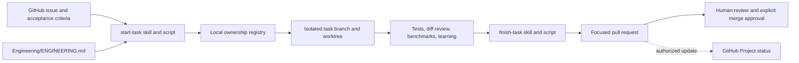

# Workflow architecture

The workflow separates decisions, repeatable operations, and evidence. Agent instructions define engineering obligations; skills guide task-specific reasoning; PowerShell scripts protect local Git operations; GitHub Issues and Projects remain the shared planning record.

## Files and responsibilities

| Component | Responsibility |
| --- | --- |
| `Engineering/ENGINEERING.md` | Canonical reusable engineering policy |
| Root `AGENTS.md`, `CLAUDE.md`, `.cursor/rules/engineering.mdc` | Agent-specific instruction discovery and reference |
| `Engineering/skills/<name>/SKILL.md` | Canonical procedure for each of the five skills |
| `.agents/skills/<name>/SKILL.md` | Discoverable Codex/Cursor entrypoints that load canonical procedures |
| `.claude/skills/<name>/SKILL.md` | Discoverable Claude entrypoints that load canonical procedures |
| `Engineering/scripts/` | Deterministic local coordination and authorized publication |
| `Engineering/scripts/install-workflow.ps1` | Explicit repository-only installation with conflict preflight; preserves nonempty existing configuration |
| Git common directory | Machine-local ownership and concurrency metadata shared by linked worktrees |
| GitHub issue and PR | Durable acceptance criteria, dependency links, review, and handoff |
| GitHub Project | Visible planning state; updated only when authorized and supported |

Discovery wrappers intentionally contain little policy. Update the canonical file rather than editing independent copies in three tool directories. A Markdown reference in an instruction tells the agent to read the target; it is not a universal native import. Claude's `@` import is native syntax. No Windows symlink, administrator privilege, service, database, or daemon is required.

## What a worktree isolates

A Git repository stores commit, tree, and blob objects in an object database. Branch refs point to commit IDs. A linked worktree reuses this database and most refs, so creating one avoids copying the full history. Each worktree has its own checked-out files, `HEAD`, and index. The index is the staging area: `git add` in one worktree does not stage another worktree's edits. The worktree's `.git` file points to its administrative directory. These boundaries explain why parallel agents can edit and stage independently while seeing the same branch namespace. Sources: [Git repository layout](https://git-scm.com/docs/gitrepository-layout), [Git worktrees](https://git-scm.com/docs/git-worktree).

Use `git rev-parse --git-common-dir` to locate shared metadata; do not assume `.git` is a directory. Git normally prevents checking out one branch in two worktrees. Independent tasks therefore require distinct branches, even when their files differ. Shared objects do not provide independent network remotes, repository configuration, branch refs, hooks, or integration state. Coordinate operations that affect those shared resources. Source: [Git worktrees](https://git-scm.com/docs/git-worktree).

Worktrees do not isolate running applications, ports, databases, temporary directories, external services, package caches, or Windows settings. Give test servers separate ports and disposable data. Do not run system optimization or other machine-changing application actions as a side effect of this workflow.

## Ownership and concurrency

Ownership has three dimensions: issue, unique agent session, and claimed repository-relative paths. Use identifiers such as `codex-api-20261124-a`, not a generic `codex` identity shared by concurrent sessions. A claim records responsibility; it does not prove a process is alive. An old claim is not automatically safe to steal.

Scripts serialize registry mutations and shared worktree/ref changes through a repository-wide exclusive lock. They validate ownership and overlaps while holding that lock, then persist state before allowing another creation request to proceed. Different scripts and agent sessions use the same Git common directory. This protects cooperating callers against a check-then-create race. Git's own ref/index locks protect individual Git writes; neither lock replaces the other.

The shared state directory is `<git-common-dir>/engineering-workflow/`. `tasks.json` holds the issue-keyed registry; `workflow.lock` is opened with exclusive file sharing. The operating system releases the open handle when a process exits, so an empty leftover lock file is harmless. Registry writes use a temporary file and replacement to avoid exposing a partially written JSON document. A damaged registry stops the operation instead of being silently replaced. Lock acquisition times out with a useful error rather than waiting indefinitely.

Declared file ownership prevents predictable overlap before code changes. Claim shared interfaces, dependency manifests, lockfiles, migrations, and generated outputs explicitly. If two tasks need a shared contract, assign one owner to land the contract first, or divide ownership into separate non-overlapping files. Other agents consume the agreed API and document dependencies in their issues/PRs.

The lock and registry are local to one clone. Another clone or machine cannot see them. GitHub issue assignments, dependency links, and open PR review coordinate across machines. Agents that bypass the scripts can bypass claims; these scripts are coordination controls, not a security sandbox. Unexpected branch/worktree state requires investigation rather than automatic repair.

## Validation and publication

The planning skill inspects dependencies, active branches, linked worktrees, open PRs, and shared interfaces. Automation can enforce declared path claims and exact task ownership. It cannot infer semantic conflicts in two disjoint files, judge acceptance criteria, or establish that an issue's free-form dependency text is complete.

Finishing requires relevant tests and inspection of the actual diff. A failed test must stop commit/push/PR automation. Explicit changed-file selection limits accidental staging. Publication is opt-in; an existing pull request is reused rather than duplicated. A push or API failure must leave a recoverable local task and a useful error. Tests and commits are evidence for a handoff, not proof that every security or correctness risk is absent.

GitHub Project field names and status values vary. Resolve the intended project, item, field, and single-select option before writing. The CLI supports explicit GraphQL IDs through `gh project item-edit`; a successful repository push does not establish Projects write access. Treat a missing project scope, unsupported command, or rejected field update as a reported limitation, not a reason to request broader permissions automatically. Sources: [Project item editing](https://cli.github.com/manual/gh_project_item-edit), [CLI authorization scopes](https://cli.github.com/manual/gh_auth_refresh).

Merging, branch deletion, destructive cleanup, history rewriting, credential changes, and Windows/system configuration changes require separate explicit approval. None belongs in automatic task completion.

## Recovery and safe cleanup

Keep a failed operation's branch and files for inspection. Re-run status and verify the task owner before retrying. Never resolve contention by deleting another session's lock file, discarding its work, or moving its branch. A lock file can exist without an open lock handle; file existence alone does not establish an active operation.

Before approved cleanup, verify the absolute worktree path, expected branch, registry owner, clean status including untracked and ignored files, and merge ancestry against the freshly fetched integration branch. Unmerged work remains valuable even if its issue is closed. GitHub's PR state alone is insufficient after squash/rebase merges: inspect the integrated result and preserve the original branch until the user authorizes deletion.

The status script's separately approved cleanup mode uses `git worktree remove` without force and then `git branch -d`, after requiring ancestry into the local base. It refuses unmerged branches. Do not recursively delete a worktree directory or delete its branch to make the workflow appear clean. Source: [Git worktree removal](https://git-scm.com/docs/git-worktree).
